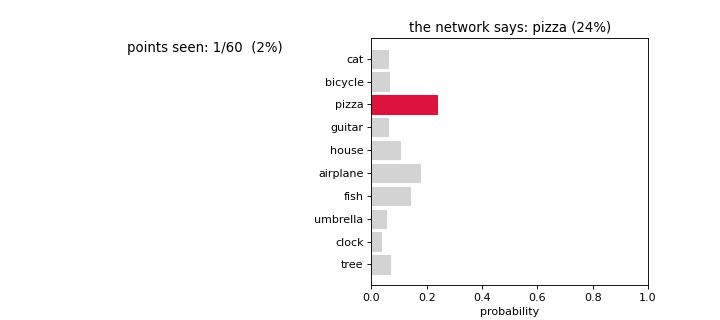
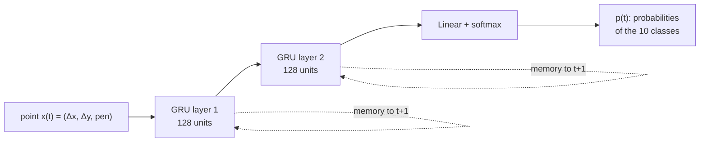

# RNN---GRU---Recognizing-a-Sketch-While-It-Is-Being-Drawn

## Recognizing a Sketch While It Is Being Drawn

A recurrent neural network (GRU) reads a *Quick, Draw!* sketch **one pen point at a time** and, after
every point, predicts which of 10 objects is being drawn. It does not need the finished drawing:
with half of the sketch it is already right 88% of the time.



*A circle is a "clock" until the ears appear; then the network switches to "cat".*

## Data

[Quick, Draw!](https://github.com/googlecreativelab/quickdraw-dataset) (Google) is a collection of
millions of doodles drawn by people in 20 seconds. We use the stroke version prepared for Sketch-RNN:
a sketch is **not an image but a time series of pen movements** (format *stroke-3*). Each sketch is a
table with **one row per point** (time) and **three columns** (features): Δx, Δy, pen.
The cat above, as it is stored (shape 60 × 3):

| point *t* | Δx | Δy | pen |
|:-:|--:|--:|:-:|
| 1 | 58 | 20 | 0 |
| 2 | 29 | 7 | 0 |
| 3 | 34 | 3 | 0 |
| … | … | … | … |
| 28 | 10 | 0 | **1** |
| 29 | 10 | −207 | 0 |
| … | … | … | … |
| 60 | 0 | 11 | **1** |

Δx, Δy are the displacement in pixels from the previous point; `pen = 1` means the pen is lifted after
this point (end of a stroke). The jump Δy = −207 at point 29 is the pen moving to draw an ear.
The GRU reads this table one row at a time: at step $t$ its input is the row $x_t = (\Delta x, \Delta y, \text{pen})$.

- **10 classes:** cat, bicycle, pizza, guitar, house, airplane, fish, umbrella, clock, tree
- sketches with at most 100 points (about 90% of all sketches)
- **100,000** training sketches (10,000 per class), **23,609** validation, **23,537** test
- Δx, Δy are standardized with the training set; shorter sketches are zero-padded to 100 rows

## Model



At every point $t$ the same network (same weights) updates the memory of its two GRU layers and
outputs a prediction:

$$h^{(1)}_t = \mathrm{GRU}_1\big(x_t,\ h^{(1)}_{t-1}\big), \qquad h^{(2)}_t = \mathrm{GRU}_2\big(h^{(1)}_t,\ h^{(2)}_{t-1}\big), \qquad p_t = \mathrm{softmax}\big(W h^{(2)}_t + b\big)$$

- **Loss:** cross-entropy computed **after every real point** (padding masked out), so the network
  learns to recognize unfinished sketches too.
- **Training:** Adam, batch 256, 6 epochs (about 9 minutes on a laptop CPU).
- **Hyperparameters:** GRU size {64, **128**} × learning rate {10⁻³, **3·10⁻³**}, chosen on the
  validation set.
- **Baseline:** multinomial logistic regression (softmax) on the whole sketch flattened into
  100 × 3 numbers: same output, but no memory and no notion of order.

## Results (test set)

| | Accuracy | With half of the sketch |
|---|---|---|
| Random guessing | 10.0% | 10.0% |
| Logistic regression | 54.0% | 23.5% |
| **GRU** | **95.5%** | **88.0%** |

Macro F1 0.955, macro ROC AUC 0.999. The most frequent error is *clock* → *pizza* (8%): two circles
with lines inside.

## Repository

| File | Content |
|---|---|
| `quickdraw_gru.ipynb` | the whole project: data, model, hyperparameter search, training, baseline, results |
| `animation.py` | functions to draw a sketch and make the animation |
| `gru_model.pt` | trained weights and loss history (loaded instead of retraining) |
| `hparam_search.json` | results of the hyperparameter search |
| `presentation/` | slides as PDF (LaTeX/Beamer) and HTML, plus the scripts that build them |

## How to run

```bash
pip install torch numpy matplotlib scikit-learn pillow
```

Open `quickdraw_gru.ipynb` and run all cells. The data (10 files, ~120 MB) is downloaded automatically into `data/`.
To retrain from scratch, delete `gru_model.pt` and `hparam_search.json`.

## References

- Quick, Draw! dataset, Google Creative Lab
- K. Cho et al., *Learning Phrase Representations using RNN Encoder–Decoder*, 2014 (GRU)
- D. Ha, D. Eck, *A Neural Representation of Sketch Drawings*, 2017 (Sketch-RNN and the stroke-3 format)
